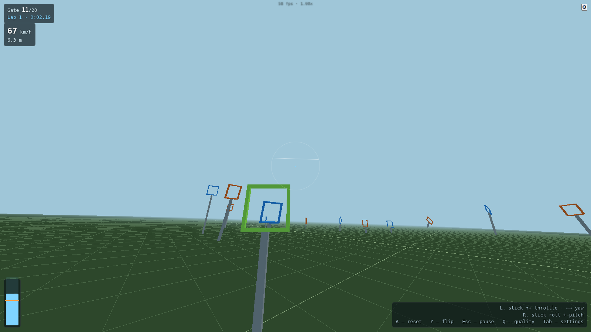
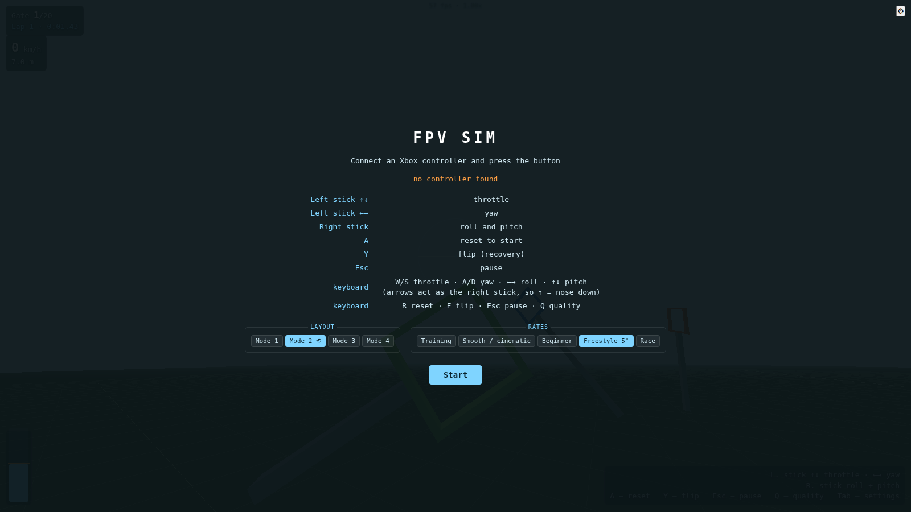
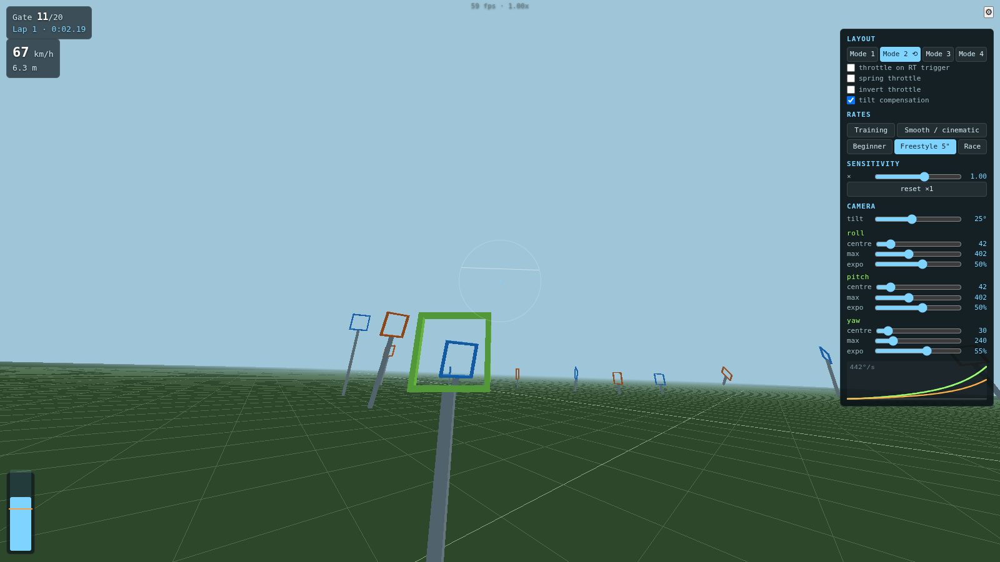

# FPV Sim

Browser FPV quadcopter simulator, flown from an Xbox controller or the keyboard.
Real quadcopter physics, and the whole track renders in one draw call.

**Live demo: <https://dsidxavekko.github.io/fpv-sim/>** — no build step, clone it and
it runs.



## Run it

```sh
git clone https://github.com/dsidxavekko/fpv-sim
cd fpv-sim
python3 -m http.server 8000
```

Open <http://localhost:8000>. Nothing to build — three.js comes from a CDN, and every
path in the project is relative, so it runs from any static host.

## Controls



**Mode 2** by default — switchable to ⚙ / Tab while flying:

| | Left stick | Right stick |
|---|---|---|
| Mode 1 | roll + pitch | throttle + yaw |
| **Mode 2 ⟲** | throttle + **inverted** yaw | roll + pitch |
| Mode 3 | pitch + yaw | throttle + roll |
| Mode 4 | throttle + roll | pitch + yaw |

In Mode 2 the left stick is flipped horizontally: push right, yaw left. The other three
axes stay standard. The flags live in the layout data (`LAYOUTS[].invert`), so it is
just data rather than a separate branch in the code.

**Throttle lever** (on by default): stick centred = 50 % throttle, and the lever stays
where you left it until the stick moves off centre again — the way a real radio works.
It starts trimmed for hover, so the quad does not drop on the start line. **Spring
throttle** (a toggle in settings) gives gamepad behaviour: stick centred = idle,
release and you slow down. It feels more natural on a gamepad, but **it is not how a
real transmitter behaves**.

Also available: throttle on the RT trigger, inverted throttle, tilt compensation.

The **sensitivity** slider (0.3–1.5) multiplies every rate at once, so presets do not
need rewriting. Flips ignore it — a flip is always full power.

| | |
|---|---|
| A | reset to start |
| Y | flip |
| Start / Esc | pause |
| Tab | settings panel |
| Q | render scale by hand |

Keyboard: `W/S` throttle, `A/D` yaw, arrow keys roll and pitch, `R` reset, `F` flip.
The arrows mirror the right stick, so `↑` is nose down.

## Rates

A faithful port of Betaflight **Actual Rates** (the formula from firmware, PR #9495):

```js
rate(u) = u·centre + (max − centre)·|u|·(u⁵·expo + u·(1 − expo))
```

Zero at centre, exactly `max` at the edge, expo only moves where the curve bends. Three
numbers per axis, separate for roll, pitch and yaw.

Presets (deg/s at 25 % / 50 % / 100 % stick):

| Preset | roll/pitch | 25 % | 50 % | 100 % |
|---|---|---|---|---|
| Training | 20 / 200 / 55 % | 10 | 32 | 200 |
| Smooth / cinematic | 15 / 270 / 75 % | 8 | 26 | 270 |
| Beginner | 18 / 240 / 70 % | 9 | 28 | 240 |
| **Freestyle 5"** (default) | 42 / 402 / 50 % | 22 | 69 | 402 |
| Race | 72 / 450 / 42 % | 32 | 93 | 450 |

These numbers run lower than what you would enter on a real Betaflight board, on
purpose. **The rates are tuned for a controller, not a gamepad**: a radio gives ~55 mm
of stick throw plus a physical expo dial, a gamepad gives ~20 mm and nothing else. The
same figures feel two or three times hotter on a pad. The 450 °/s ceiling is enforced by
a test.

Yaw is always calmer than roll — that is how real pilots fly. Everything is adjustable
with sliders and persists in localStorage.

Camera angle (⚙ → CAMERA, 0–60°) — real FPV lenses ship at 26/30/45°, and it decides
how far down you can see.

## Ghost and records

The lap is sampled at 20 Hz and stored in localStorage, **but only when it beats the
previous best** — so the ghost is always the lap you are trying to copy. On the next
lap it flies alongside you, and the split by the gate counter shows the delta:
`−0.31` in green means you are ahead, `+0.44` in orange means you are behind. The delta
comes from the best splits: at the same gate, your time against the ghost's.

Your record lives in localStorage too, so reloading the tab does not wipe it. A lap is
about 60 KB, so localStorage (~5 MB) holds hundreds of them.

## Physics

Acro mode: the stick commands a rotation rate, PID produces a moment, and the mixer
distributes it across the four motors.

- thrust `T = thrustMax · cmd²` (the physically correct dependence on RPM)
- the moment is derived from the levers, `τ = r × F`, not from a separate formula
- gyroscopic coupling between axes, quadratic drag per body axis
- motor lag (τ = 25 ms) — without it the handling feels mushy
- **Airmode** (on by default, like Betaflight): when one channel saturates, all four
  shift together so total thrust does not sag. Without it, a hard tilt at low throttle
  quietly loses thrust
- **Tilt compensation** scales thrust by `1/cos(tilt)` so roll and pitch do not change
  altitude. On by default; **real quads do not fly like this**, it is a convenience for
  a simulator
- drag 0.045 on the frontal axes: peak horizontal speed **139 km/h**, cruise 72 — the
  real range of a 5" quad. It used to be 190, which meant the sim flew faster than a
  real drone
- a flip multiplies rotation rate by ×2, otherwise a full 360° would take a second on
  soft rates

Every coefficient lives in the `CFG` object at the top of `src/physics.js`.

## Tests

```sh
node test/rates.test.mjs     # rate curve + mapping of all 4 layouts
node test/physics.test.mjs   # hover, freefall, roll ramp, flip, 60 s of random input
```

Collision runs in the browser, because `world.js` imports three, which node does not
resolve. With the server up, open <http://localhost:8000/test/collide.html>: it sweeps
every gate through 364 thousand contact states, and fewer than 0.5 % of cases should end
in the frame (currently 0.04 %, mean overshoot 0.1 mm).



## On a weak PC

No textures, no shadows, no post-processing. Every gate is a single `InstancedMesh`. If
fps drops below 45, the render scale automatically falls to 0.5.

## Layout

```
index.html            canvas, HUD, settings panel, importmap
src/physics.js        quad model + rate curve
src/settings.js       layouts, presets, localStorage
src/input.js          Gamepad API + keyboard, mapped through the layout
src/world.js          track, collision, gate counting
src/main.js           loop, camera, HUD, settings
test/
```

Contributions welcome, see [CONTRIBUTING.md](CONTRIBUTING.md).